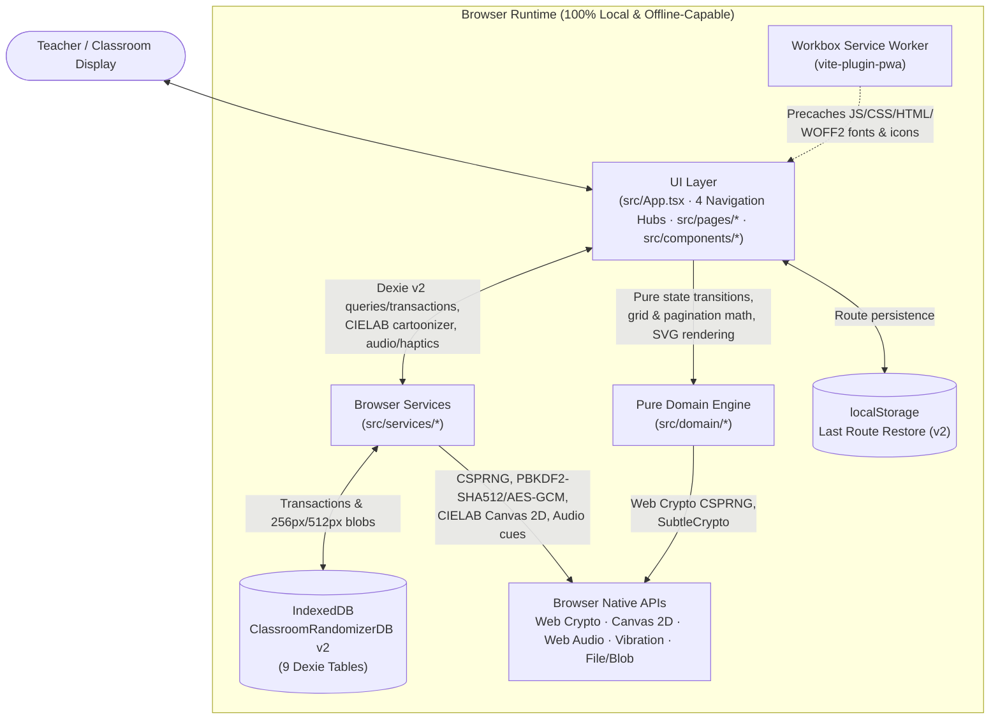
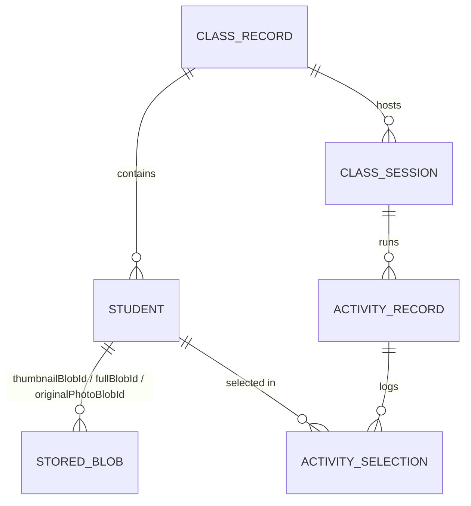

# Classroom Randomizer — Architecture & Technical Blueprint

> **Purpose of This Document:** This file is the complete technical blueprint ("blue map") for **Classroom Randomizer**. It documents every layer, file, IndexedDB table/version, pure domain function, state machine transition, cryptographic format, and visual/CIELAB pipeline so any developer, researcher, or AI assistant can immediately understand and safely extend the application.
>
> **Last Synced With Codebase:** Spec v2.0 — covers all modules in `src/domain/`, `src/services/`, `src/components/`, `src/pages/`, `src/App.tsx`, `src/index.css`, and `vite.config.ts`.

---

## 1. High-Level System Architecture

**Classroom Randomizer** is a **100% client-side, local-first, offline-capable Progressive Web App (PWA)** built with React 19, TypeScript, Tailwind CSS v4, and Dexie (IndexedDB).

### Core Architectural Principles
1. **Zero Network Calls for Student Data:** All rosters, attendance logs, session histories, procedural 3D avatars, and locally processed student photographs stay exclusively inside IndexedDB (`ClassroomRandomizerDB`).
2. **Pure, Testable Domain Core (`src/domain/`):** Cryptographic randomness, natural roll sorting, fairness weighting, eligibility, deck state transitions (with 350ms settle lock), responsive grid & pagination math, 3D SVG mascot/human generation, schema migration validators, CSV parsing, and V1/V2 AES-GCM encryption live in framework-free TypeScript modules tested with `node:test`.
3. **Strict Privacy-Before-Reveal DOM Contract:** Unrevealed mystery cards never mount student names, roll numbers, or avatars into the DOM while `state === 'hidden'`.
4. **Fair Avatar Policy (`Mascot` Default + Explicit `MST 1–10` + `Legacy` Preservation):** New students default to non-human 3D **Classroom Mascots** (`scholarOwl`, `cleverFox`, `cozyPanda`, `sparkBot`, `starExplorer`, `sunnySprout`). Human characters expose all **10 Monk Skin Tone (`MST 1–10`)** swatches explicitly for teacher selection—never inferred from names or randomized without consent—and outfit randomization preserves the selected skin tone. Existing v1 avatars preserve `avatarKind: 'legacy'` during Dexie `version(2)` migration.

> **Template Dependencies Note:** `package.json` retains `@google/genai`, `express`, and `dotenv` from the workspace starter, and `metadata.json` keeps starter capability metadata. At runtime, the app runs strictly as a local browser SPA/PWA with **zero** server or LLM API calls.

### System Data-Flow Diagram



---

## 2. Directory & File Inventory

```text
/
├── index.html                          # HTML shell, title & OpenGraph metadata
├── metadata.json                       # Workspace manifest metadata
├── package.json                        # Scripts & dependencies (incl. @fontsource, dexie, xlsx, lucide-react)
├── tsconfig.json                       # TypeScript config (@/* alias -> ./*)
├── vite.config.ts                      # Vite + Tailwind v4 + VitePWA + asset copy plugin
├── README.md                           # Project overview & quick-start guide
├── ARCHITECTURE.md                     # This complete technical blueprint
├── public/                             # Static PWA & icon assets
│   ├── icon.svg
│   ├── apple-touch-icon.png
│   ├── pwa-192x192.png
│   ├── pwa-512x512.png
│   └── pwa-maskable-512x512.png
└── src/
    ├── main.tsx                        # React 19 root mount, @fontsource fonts (Fredoka, Plus Jakarta Sans, JetBrains Mono), SW registration
    ├── index.css                       # Tailwind v4, Warm Ivory :root tokens, safe-area CSS, 3D flip & print CSS
    ├── App.tsx                         # App state hydration, 4-hub navigation rail/bottom bar, route stack & modals
    ├── domain/                         # Pure TypeScript business logic & node:test unit tests
    │   ├── types.ts                    # Canonical Spec v2.0 interfaces & union types
    │   ├── random.ts                   # Web Crypto CSPRNG (fail-closed), Fisher-Yates, natural roll sorting & parser
    │   ├── eligibility.ts              # Attendance filtering, fairness weights, duty totals, slots & balanced groups
    │   ├── deckStateMachine.ts         # 2-tap Reveal -> 350ms settle Confirm -> Undo -> Reshuffle FSM
    │   ├── deckLayout.ts               # Single-screen auto-fit grid math (0.68–0.92 aspect) & quick-tab pagination
    │   ├── avatarGenerator.ts          # 3D clay-style Mascot, Human (MST 1–10), & Legacy SVG generator
    │   ├── migration.ts                # Pure Dexie v1 -> v2 record upgraders & record-count invariant checker
    │   ├── csvParser.ts                # RFC-4180 CSV parser & roster import validation
    │   ├── cryptoBackup.ts             # V2 chunked PBKDF2-SHA512 + AES-GCM-256 (.classpack) & V1 decrypt compatibility
    │   └── *.test.ts                   # 6 pure domain test suites
    ├── services/                       # Browser-side persistence & hardware adapters
    │   ├── db.ts                       # Dexie v2 IndexedDB schema & upgrade(), blob helpers, storage quota check
    │   ├── seedService.ts              # First-launch seed (Class 5–7, 8 students each with Mascots, 10 questions, 8 duties/rewards)
    │   ├── photoProcessor.ts           # On-device Canvas 2D + CIELAB (L*a*b*) photo stylizer, 256/512px outputs & ΔE check
    │   ├── photoProcessor.test.ts      # Pure CIELAB round-trip & skin-tone preservation unit tests
    │   ├── soundService.ts             # Web Audio synthesized sound cues & navigator.vibrate() haptic patterns
    │   ├── exportService.ts            # Blob download & RFC-4180 CSV writer
    │   └── pwaHook.ts                  # useOnlineStatus() & usePWAInstall() hooks
    ├── components/                     # Reusable visual primitives & dialogs
    │   ├── StudentAvatar.tsx           # Resolves thumb/full blob URL or deterministic 3D Mascot/Human/Legacy SVG
    │   ├── CardBackArtwork.tsx         # Clue-free symmetrical vector card backs (4 themes × 6 variants)
    │   ├── StudentCard.tsx             # StudentCardFront & MysteryFlipCard (with strict DOM privacy guard & lifted state)
    │   ├── CinematicRevealOverlay.tsx  # Full-screen GPU FLIP + 3D flip spotlight (~3.5s hold, Cancel, fly-to-panel)
    │   ├── ConfirmDialog.tsx           # Accessible modal confirmation dialog
    │   ├── StudentFormModal.tsx        # Add/edit/transfer student + Mascot/Human/Legacy avatar preview
    │   ├── ImportStudentsModal.tsx     # CSV/TSV & SheetJS (.xlsx/.xls) importer + column mapper
    │   └── PhotoUploadModal.tsx        # 2-step roll match + CIELAB photo cartoonizer + ΔE validation status
    └── pages/                          # Hub wrappers & workflow views
        ├── DashboardPage.tsx           # Classes Launchpad (primary 1-tap Start/Resume Session hub)
        ├── RosterStudioHubPage.tsx     # Tabbed hub: Students | 3D Avatar Studio | Card Collection
        ├── DecksHistoryHubPage.tsx     # Tabbed hub: Question Decks & Duties | Participation & Sessions
        ├── ClassesAndOverviewPage.tsx  # Exports ClassesPage & ClassOverviewPage
        ├── AttendancePage.tsx          # Roll-sorted All-Present attendance + inline unknown/duplicate roll validation
        ├── StudentsPage.tsx            # Roster table with class filter, archive toggle & avatar source labels
        ├── CharacterStudioPage.tsx     # Mascot / MST 1–10 Human / Legacy studio + Delete Retained Original Photo
        ├── CardCollectionPage.tsx      # Natural roll-sorted card front/back browser + CardBackTheme switcher
        ├── ActivityCenterPage.tsx      # 5-card Activity Dock + More Activities drawer + fairness/duty summary
        ├── MysteryDeckPage.tsx         # Single-screen h-dvh deck, spotlight orchestration & refresh recovery, landscape HUD, completion view
        ├── GroupGeneratorPage.tsx      # Balanced Team Builder with click-to-swap, print & DB save
        ├── QuestionsTasksPage.tsx      # Manage question decks, CSV import, duties (with live totals) & rewards
        ├── HistoryReportsPage.tsx      # Real participation totals, duty counts, structured session timeline & print/CSV
        └── SettingsBackupPage.tsx      # Audio/haptics/shortcuts/motion prefs, storage quota bar, V2 chunked backup & reset
```

---

## 3. Data Model & IndexedDB Schema (`src/domain/types.ts` & `src/services/db.ts`)

### Dexie Database: `ClassroomRandomizerDB` (Version 2)

`db.ts` defines `version(1)` and `version(2)` with an in-place non-destructive `.upgrade()` transaction backed by pure functions in `src/domain/migration.ts`:

| Table Name | Primary Key | Indexed Fields | Purpose |
| :--- | :--- | :--- | :--- |
| `classes` | `id` | `name`, `archivedAt`, `createdAt` | Class groups (`Class 5`, `Class 6`, `Class 7`, custom classes) |
| `students` | `id` | `classId`, `rollNumber`, `name`, `activeStatus`, `[classId+activeStatus]` | Student profiles, presentation, `avatarConfig`, plus optional `avatarBlobId`, `thumbnailBlobId` (`256px`), `fullBlobId` (`512px`), `originalPhotoBlobId` |
| `blobs` | `id` | `createdAt` | Base64 Data URLs (`image/webp` or `image/png` stylized avatars, `image/jpeg` optional retained originals) |
| `sessions` | `id` | `classId`, `status`, `startedAt`, `[classId+status]` | Classroom teaching sessions tracking `absentStudentIds`, `lateArrivalsIds`, `earlyDeparturesIds`, and chronological `attendanceLog: AttendanceLogEntry[]` |
| `activities` | `id` | `sessionId`, `classId`, `status`, `createdAt` | Activity rounds storing `deckSlots`, `selectedStudentIds`, `pendingRevealedAt`, `groups`, `questionAssignments`, `rewardAssignments`, `deckBackSeed` |
| `selections` | `id` | `activityId`, `sessionId`, `classId`, `studentId`, `selectedAt`, `undoneAt` | Append-only participation ledger; undone picks set `undoneAt` rather than deleting records |
| `questions` | `id` | `subject`, `createdAt` | Subject-tagged classroom question bank |
| `rewards` | `id` | `kind`, `createdAt` | Classroom `duty`, `reward`, and `challenge` items |
| `settings` | `id` | *(singleton `'app_settings'`)* | Global audio, haptics, keyboard shortcuts, fairness scope, card-back theme, and backup timestamps |

### Key Type Definitions (`src/domain/types.ts`)
- **Avatar & Presentation:**
  - `CharacterPresentation`: `'masculine' | 'feminine' | 'neutral' | 'random'`
  - `AvatarKind`: `'mascot' | 'human' | 'legacy'`
  - `MascotId`: `'scholarOwl' | 'cleverFox' | 'cozyPanda' | 'sparkBot' | 'starExplorer' | 'sunnySprout'`
  - `SkinToneScale`: `1 | 2 | 3 | 4 | 5 | 6 | 7 | 8 | 9 | 10` (10 Monk Skin Tone hexes)
  - `AvatarConfig`: `{ seed, avatarKind?, mascotId?, skinToneScale?, presentation, skinTone, faceShape, hairStyle, hairColor, eyeStyle, eyebrowStyle, mouthStyle, outfitStyle, outfitColor, accessory, bgPattern, bgColor }`
- **Sessions & Attendance Audit:**
  - `AttendanceLogEntry`: `{ id: string; studentId: string; type: 'late_arrival' | 'left_early'; timestamp: number; note?: string }`
- **Activities & Fairness:**
  - `ActivityType`: `'single_pick' | 'two_toss' | 'groups' | 'student_question' | 'lucky_picker' | 'mystery_reward'`
  - `SelectionMode`: `'pure_random' | 'balanced' | 'least_recent'`
  - `RepeatPolicy`: `'no_repeat' | 'allow_repeat'`
  - `FairnessScope`: `'current_session' | 'recent_sessions' | 'all_history'`
  - `CardBackTheme`: `'botanical' | 'geometric' | 'constellation' | 'terracotta'`
  - `DeckSlotState`: `'hidden' | 'pending_reveal' | 'empty'`

### Default Settings (`DEFAULT_APP_SETTINGS`)
```ts
{
  id: 'app_settings',
  theme: 'light', // Canonical Warm Ivory (no dark mode toggle)
  soundEnabled: true,
  hapticsEnabled: true,
  keyboardShortcutsEnabled: true,
  reduceMotion: false,
  lowPerformanceMode: false,
  defaultSelectionMode: 'pure_random',
  defaultRepeatPolicy: 'no_repeat',
  fairnessScope: 'current_session',
  cardBackTheme: 'terracotta',
  backupReminderDays: 7,
  seededSampleData: false,
}
```

### Entity Relationship Diagram



---

## 4. Application Shell & 4-Hub Routing (`src/App.tsx`)

`App.tsx` manages reactive Dexie hydration (`reloadAllFromDb()`), first-launch seeding (`ensureInitialDatabaseSeeded()`), navigation history stack with browser `popstate` sync, `localStorage` route recovery (`ROUTE_STORAGE_KEY = 'classroom_randomizer_last_route_v2'`), mid-session attendance diff logging (`AttendanceLogEntry`), and shared modals.

### Canonical 4 Navigation Hubs

| Hub ID | Desktop / Mobile Label | Route | Primary Views Inside Hub |
| :--- | :--- | :--- | :--- |
| `classes_hub` | `Classes` | `dashboard` (+ nested `classes`, `class_overview`, `attendance`, `activity_center`, `mystery_deck`, `group_generator`) | Classes Launchpad -> Attendance -> Activity Dock -> Mystery Deck / Team Builder |
| `roster_hub` | `Roster & 3D Studio` / `Roster` | `roster_studio` (`tab: 'students' \| 'studio' \| 'cards'`) | Tabbed hub hosting `StudentsPage`, `CharacterStudioPage`, and `CardCollectionPage` |
| `decks_hub` | `Decks & History` / `Decks` | `decks_history` (`tab: 'questions' \| 'history'`) | Tabbed hub hosting `QuestionsTasksPage` and `HistoryReportsPage` |
| `settings_hub` | `Backup & Settings` / `Backup` | `settings` | `SettingsBackupPage` (preferences, storage quota, V2 backup/restore, Danger Zone) |

### Responsive Viewport & Mobile Rotation Rules (`src/App.tsx` & `src/index.css`)
- **Desktop Left Rail:** `hidden md:[@media(min-height:541px)]:flex md:w-56` — automatically collapses on mobile and short rotated landscape screens (`height <= 540px`), exposing the mobile slide-over drawer button instead.
- **Mystery Deck Viewport Lock (`isDeckRoute`):** Locks main container to `h-dvh overflow-hidden`, compacts the top header (`py-1 sm:py-1.5`), hides the header `Start/Resume Session` button, and hides the portrait mobile bottom bar.
- **Safe-Area CSS Separation (`src/index.css`):** `.safe-area-header`, `.safe-area-x`, `.safe-area-deck`, and `.safe-area-bottom` isolate `env(safe-area-inset-*)` padding from inner Tailwind `px-*` / `py-*` containers so unlayered `0px` defaults never zero out page horizontal breathing room.

---

## 5. Pure Domain Engine (`src/domain/`) — Function Catalog

### 5.1 Cryptographic Randomness, Natural Roll Sort & Parser (`src/domain/random.ts`)
| Export | Behavior |
| :--- | :--- |
| `SecureRandomUnavailableError` | Typed error thrown when `crypto.getRandomValues` is missing (fail-closed policy for classroom picks—no silent `Math.random()` fallback when no custom test RNG is supplied). |
| `secureRandomInt(maxExclusive, rng?)` | Unbiased integer in `[0, maxExclusive)` via Web Crypto **rejection sampling** (`limit = 2^32 - (2^32 % maxExclusive)`). |
| `shuffleArray(items, rng?)` | Unbiased Fisher-Yates shuffle returning a new array. |
| `compareRollNumbers(a, b)` / `sortStudentsNaturally(students)` | Natural numeric/alphanumeric roll comparator (`1, 2, 10, 501, 502`) with deterministic name tie-breaking. |
| `parseRollNumberInput(rawInput, activeClassStudents)` | Splits comma/whitespace/semicolon input, matches active class students case-insensitively, and returns `{ validStudentIds, matchedRolls, duplicateRolls, unknownRolls }`. |

### 5.2 Eligibility, Fairness & Group Distribution (`src/domain/eligibility.ts`)
| Export | Behavior |
| :--- | :--- |
| `getEligibleStudents(options)` | Filters active class members excluding `session.absentStudentIds`, `excludeIds`, and (when `no_repeat`) `alreadySelectedIds`. |
| `filterHistoryByScope(...)` | Excludes undone selections (`!sel.undoneAt`) and scopes to `current_session`, `recent_sessions` (current + up to 5 prior), or `all_history`. |
| `computeFairnessWeights(eligible, scopedSelections, mode)` | Computes weight & normalized probability share (`pure_random` -> `1`, `balanced` -> `1 / (1 + count)`, `least_recent` -> monotonic oldest-first priority with never-picked bonus). |
| `computeDutyAssignmentCounts(selections, classId?)` | Aggregates per-student duty counts and last timestamp. |
| `computeDutyTitleCounts(selections, classId?)` | Aggregates how many times each `dutyTitle` has been assigned in a class/overall (displayed in `ActivityCenterPage`, `QuestionsTasksPage`, and `HistoryReportsPage`). |
| `getActivityDisplayLabel(type)` | Canonical human-readable labels (`Mystery Pick`, `Two-Student Toss`, `Team Builder`, `Student + Question`, `Duty Picker`, `Mystery Reward / Challenge`). |
| `pickWeightedStudent(weights, rng?)` | Roulette-wheel weighted draw proportional to `weight`. |
| `createDeckSlots(...)` | Builds hidden `DeckSlot[]` with shuffled student assignments and independently shuffled `cardBackVariant` indices (`0..5`). |
| `distributeIntoGroups(eligible, options, rng?)` & `swapGroupMembers(...)` | Round-robin balanced team generator (`by_count` / `by_size`) plus pure immutable click-to-swap across teams. |

### 5.3 Mystery Deck State Machine (`src/domain/deckStateMachine.ts`)

```mermaid
stateDiagram-v2
    [*] --> hidden : createDeckSlots()
    hidden --> pending_reveal : "Card Tap: revealDeckSlot()\n(lifts card into spotlight + 3D flip;\nswap-samples if Balanced/Least Recent)"
    pending_reveal --> hidden : "cancelPendingReveal()\n(Cancel Reveal / Esc)"
    pending_reveal --> empty : "Auto-confirm after ~3.5s spotlight + fly-to-panel:\nconfirmPendingReveal() when no_repeat or two_toss"
    pending_reveal --> hidden : "Auto-confirm after ~3.5s spotlight + fly-to-panel:\nconfirmPendingReveal() when allow_repeat (reshuffles hidden)"
    empty --> hidden : "undoLastSelection()\n(restores eligible student & reshuffles)"
```

- **Timing & Recovery Constants (`deckStateMachine.ts`):** `SPOTLIGHT_LIFT_MS = 360`, `SPOTLIGHT_HOLD_MS = 3500`, `SPOTLIGHT_FLY_MS = 460`, `CONFIRM_SETTLE_MS = 350`, plus `computeRemainingSpotlightHoldMs(pendingRevealedAt, now)` to resume interrupted `pending_reveal` spotlights cleanly across page reloads (keeping at least `1200ms` so the teacher can still review or Cancel).
- **`CONFIRM_SETTLE_MS = 350`:** `confirmPendingReveal(activity, now)` rejects premature confirmations arriving within 350ms of `pendingRevealedAt` (`reason: 'too_soon_to_confirm'`).

### 5.4 Single-Screen Dynamic Grid Fit, Centering & Auto-Pagination (`src/domain/deckLayout.ts`)
| Export | Behavior |
| :--- | :--- |
| `MIN_CARD_ASPECT` (`0.68`) / `MAX_CARD_ASPECT` (`0.92`) / `MIN_DECK_TOUCH_PX` (`28`) | Clamps card geometry cleanly for both tall portrait and compact rotated mobile landscape grids while enforcing a minimum `28px` touch dimension. |
| `computeOptimalDeckGrid(cardCount, width, height)` | Evaluates `cols = 1..cardCount` maximizing `min(cardW, cardH) * 0.4 + sqrt(cardW * cardH) * 0.6` with fill efficiency, dynamic gap scaling (`4–14px`), and touch-floor bonus so shrinking remaining decks grow proportionally. |
| `computeLastRowShiftPx(cardCount, grid, orderIndex)` | Computes exact pixel offset to center an incomplete final row in the flat CSS Grid without leaving awkward empty gaps or changing DOM parent elements. |
| `computeDeckPagination(cardCount, width, height)` | Driven by remaining non-empty deck slots (`activeDeckSlots.length`): recalculates rows/cols/card dimensions on every pick, undo, resize, or orientation change, adding quick page tabs (`1–N`) only if cards would fall below `28px`. `MysteryDeckPage` pairs this with a `useLayoutEffect` FLIP pass (`translate3d` + `scale`) for smooth GPU-composited resizing and repositioning. |

### 5.5 Fair 3D Avatar Generator (`src/domain/avatarGenerator.ts`)
- **Avatar Kinds:** `'mascot'` (default for new/seeded students), `'human'`, and `'legacy'` (v1 backward compatibility).
- **`MASCOT_CATALOG` (6 Mascots):** `scholarOwl`, `cleverFox`, `cozyPanda`, `sparkBot`, `starExplorer`, `sunnySprout`.
- **`MONK_SKIN_TONES` (MST 1–10):** Explicit 10-step scale (`#F6EDE4` -> `#292420`) selectable manually by teachers in `CharacterStudioPage`; `randomizeStylePreservingSkinTone(config)` shuffles outfits/hair/accessories while locking `skinToneScale`, `skinTone`, `avatarKind`, and `mascotId`.
- **`renderAvatarSvg(config, size=240)` & `avatarSvgToDataUrl(config)`:** Deterministic 240×240 multi-stop SVG gradients (`bg3d`, `face3d`, `neck3d`, `hair3d`, `outfit3d`) with ambient drop shadow (`feDropShadow`) and glossy highlights.

### 5.6 Dexie Migration Helpers & Encrypted `.classpack` V1/V2 (`migration.ts`, `cryptoBackup.ts`)
- **`migration.ts`:** `migrateV1StudentToV2`, `migrateV1SessionToV2`, `migrateV1ActivityToV2`, `migrateV1SettingsToV2`, and `verifyMigrationIntegrity(before, after)`.
- **`cryptoBackup.ts` (`CLASSPACK_V2` & `CLASSPACK_V1`):**
  - `createEncryptedClasspackV2(data, password, options?)`: Computes SHA-256 checksum over JSON payload -> splits UTF-8 bytes into chunks (`DEFAULT_CHUNK_BYTES = 512 KB`, configurable `256 KB–1 MB`) -> derives 256-bit key with **PBKDF2-SHA512 (600,000 iterations)** -> encrypts each chunk independently with **AES-GCM-256** and per-chunk **Additional Authenticated Data (AAD)** binding `backupId`, `version`, `chunkIndex`, `chunkCount`, and `plaintextByteLength` -> emits `EncryptedClasspackV2Envelope` with live `onProgress` callbacks and `AbortSignal` support.
  - `decryptClasspack(rawFileText, password, options?)`: Auto-detects `CLASSPACK_V2` vs `CLASSPACK_V1`, enforces chunk count & AAD integrity, supports progress/cancel, verifies inner payload SHA-256, and returns `ClasspackPayload`.

---

## 6. Browser Services (`src/services/`)

| Module | Exports & Responsibilities |
| :--- | :--- |
| `db.ts` | Instantiates `ClassroomRandomizerDB` (`version(1)` + non-destructive `version(2)` upgrade), `DEFAULT_APP_SETTINGS`, `saveBlobDataUrl` (defaults to `image/webp`), `getBlobDataUrl`, `deleteBlobById`, `requestPersistentStorage()`, and `checkPersistentStorage()` (including `navigator.storage.estimate()` usage/quota). |
| `seedService.ts` | Seeds Class 5, Class 6, and Class 7 (8 students each, default **Classroom Mascots**, natural rolls `501–708`), 10 questions, and 8 duties/rewards inside one RW transaction. Zero synthetic selection history. |
| `photoProcessor.ts` | Exports pure CIELAB helpers (`rgbToLab`, `labToRgb`, `deltaE76`, `validateSkinTonePreservation`) + Canvas 2D processor `processStudentPhotoLocally`: generates both a `256×256` card thumbnail (`thumbnailDataUrl`) and a `512×512` studio portrait (`fullDataUrl`), smooths luminance (`L*`) while preserving chrominance (`a*`, `b*`), draws Sobel ink outlines, computes honest center-region `avgDeltaE` fidelity feedback, and exports WebP with automatic PNG fallback. |
| `soundService.ts` | `playSoundEffect(cue, enabled)` (Web Audio tones for `flip`, `confirm`, `shuffle`, `undo`, `complete`) + `triggerHapticFeedback(cue, enabled)` (`navigator.vibrate()` subtle pulses). |
| `exportService.ts` | `downloadTextFile`, `escapeCsvCell`, `buildCsvDocument`, `getSampleStudentCsvTemplate`. |
| `pwaHook.ts` | `useOnlineStatus()` and `usePWAInstall()`. |

---

## 7. Visualizations & Design Tokens (`src/index.css`)

- **Canonical Warm Ivory Palette (`:root`):**
  - Canvas `--canvas: #FAF6EE`, Card Surface `--surface: #FFFFFF`, Subtle Surface `--surface-subtle: #F3ECE1`, Border `--border-hairline: #E6DCC9`
  - Primary Ink `--ink: #231C16`, Muted Ink `--ink-muted: #6B5E52`
  - Terracotta `--accent: #D65A31` (Hover `#BD4A24`, Soft `#FCECE5`), Sage `--sage: #2F7D5B` (Soft `#E6F3EC`), Gold `--gold: #E6A23C` (Soft `#FDF4E3`), Crimson `--crimson: #C0392B` (Soft `#FBEAEA`)
- **Offline Bundled Fonts (`@fontsource`):**
  - `--font-display`: `"Fredoka"` (600, 700)
  - `--font-sans`: `"Plus Jakarta Sans"` (400, 500, 600, 700)
  - `--font-mono`: `"JetBrains Mono"` + `.font-mono-tabular` (`tabular-nums`)
- **Compositor-Only 3D Flip & Celebrations:** `.card-perspective`, `.card-inner.is-flipped` (`320ms cubic-bezier(0.16, 1, 0.3, 1)`), `.animate-shuffle`, `.animate-celebrate`, full `@media (prefers-reduced-motion: reduce)` and `.reduce-motion` support, plus high-contrast `@media print` styles.

---

## 8. Critical Invariants (Do Not Break)

1. **DOM Privacy Before Card Reveal:** `MysteryFlipCard` must never mount hidden student names, roll numbers, or avatars while `state === 'hidden'`.
2. **Clue-Free Card Backs:** `CardBackArtwork` must never vary by student gender, race/tone, or fairness weight; `cardBackVariant` (`0..5`) is shuffled independently.
3. **No Skin-Tone or Gender Inference:** Never infer `CharacterPresentation` or `SkinToneScale` from student names or photos. Mascots are the default; Monk Skin Tones (`1–10`) are exclusively teacher-selected, and photo cartoonization must leave `a*`/`b*` chrominance intact.
4. **350ms Reveal-to-Confirm Lock & Weighted Swap:** Never bypass `CONFIRM_SETTLE_LOCK_MS` on revealed cards, and always apply `balanced`/`least_recent` probability sampling dynamically at reveal time (`revealDeckSlot()`).
5. **Non-Destructive History & Migration:** Never delete past sessions or selection rows during v1->v2 upgrades or backup restores (`merge_skip`), and never seed synthetic selection history.

---

## 9. Verification & Testing Scope

```bash
# Type-check entire TypeScript project
npm run lint

# Run all 7 pure domain & service unit test suites (23 assertions via node:test + tsx)
npx --yes tsx --test src/domain/*.test.ts src/services/*.test.ts

# Build production SPA + Workbox PWA Service Worker into dist/
npm run build
```

Verified locally in headless Chromium (`playwright-cli`) across desktop (`1440×900` / `1280×720`), mobile portrait (`390×844`), and rotated mobile landscape (`844×390`) viewports, confirming:
- Warm Ivory workspace padding and 4-hub navigation with zero horizontal overflow and zero console errors.
- Quick Attendance invalid-roll inline error blocking, Activity Dock (`Mystery Pick` -> Team Builder), `3D Avatar Studio` 10-swatch MST customizer.
- Cinematic Mystery Reveal sequence (card lift -> 3D flip -> ~3.5s spotlight -> fly-to-panel/drawer auto-confirmation), dynamic grid resizing as cards leave the deck (zero empty picked slots, proportional growth, centered final rows, smooth FLIP transitions across picks, resize, and orientation change), DOM privacy guard, rapid-tap prevention, `Cancel Reveal (Esc)`, mid-reveal & post-confirm refresh recovery, and `Undo`.
- Physical Android/tablet touchscreen and haptic hardware playback were not executed in this container environment (haptics follow standard `navigator.vibrate` browser APIs).

---

## 10. Maintenance Protocol — Keeping This Blueprint Updated

Whenever modifying this codebase, update `ARCHITECTURE.md` (and `README.md` if user-facing features or scripts change) in the same change:

1. **Database Schema / Migration (`src/services/db.ts`, `src/domain/migration.ts`, `types.ts`):** Update Section 3.
2. **Domain / Service Functions (`src/domain/*`, `src/services/*`):** Update Section 5 or 6 and keep unit tests (`npx --yes tsx --test src/domain/*.test.ts src/services/*.test.ts`) passing.
3. **Routes / Shell / Pages (`src/App.tsx`, `src/pages/*`):** Update Section 2 and Section 4.
4. **Tokens / Visual Pipelines (`src/index.css`, `avatarGenerator.ts`, `photoProcessor.ts`):** Update Section 7 and verify Section 8 invariants remain intact.
